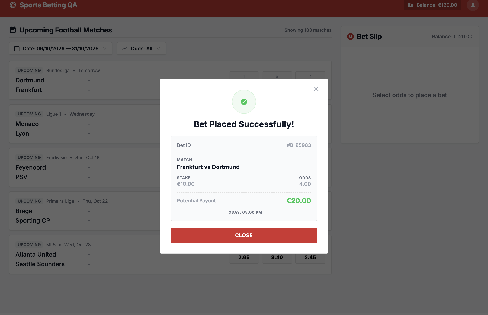
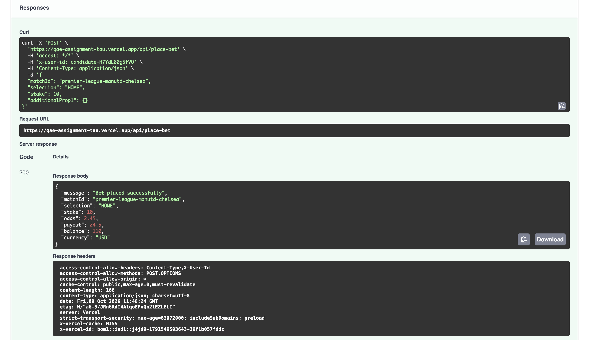
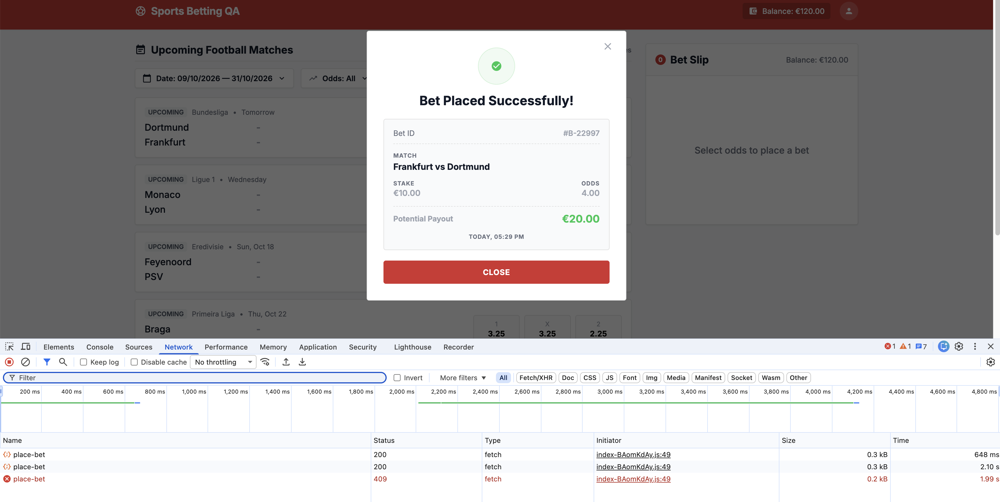
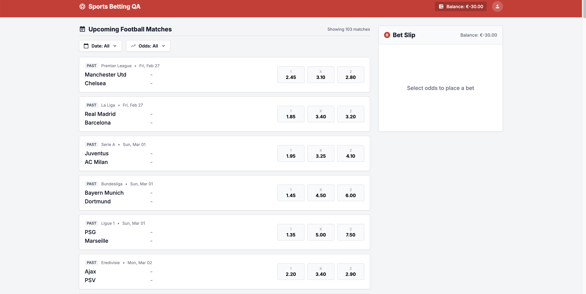
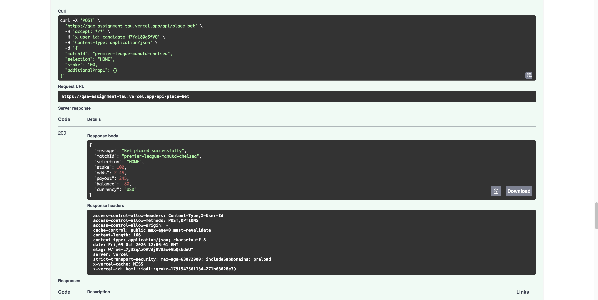

# Bug Reports — Single Bet Placement

Defects found while executing the top scenarios and a short pass around bet placement. Severity follows money impact: a double debit or a negative balance is Critical. A wrong payout, swapped teams, or a missing selection is High.

| ID | Title | Severity |
| --- | --- | --- |
| Bug 1 | UI displays incorrect initial balance after reset and an incorrect potential payout | High |
| Bug 2 | `POST /api/place-bet` returns incorrect data when placing a bet | High |
| Bug 3 | Home and away team names are swapped on the receipt | High |
| Bug 4 | Multiple clicks on Place Bet result in multiple balance deductions | Critical |
| Bug 5 | Balance becomes negative after placing bets that exceed available funds | Critical |
| Bug 6 | Success receipt does not show the selection | High |

## Bug 1: UI displays incorrect initial balance after reset and an incorrect potential payout

**Severity:** High

**Component:** UI — Bet Slip / Bet Receipt

**Steps to reproduce:**

1. Open the betting application.
2. Check the initial balance displayed in the UI.
3. Select Frankfurt vs Dortmund with odds of 4.00.
4. Enter a stake of €10.00 and place the bet.
5. Check the potential payout displayed on the receipt.
6. Refresh the page and check the updated balance.

**Expected result:**

- The initial balance should be €125.50.
- The potential payout should be €40.00 (€10.00 × 4.00).
- The balance should update to €115.50 after successfully placing the bet.

**Actual result:**

- The initial balance is displayed as €120.00 instead of €125.50.
- The receipt displays a potential payout of €20.00 instead of €40.00.
- The deducted balance is reflected in the UI only after refreshing the page.

**Impact:** The UI displays incorrect balance and payout information, which may mislead users about their available funds and expected returns.

**Evidence:**

## Bug 2: POST /api/place-bet returns incorrect data when placing a bet

**Severity:** High

**Component:** API — Place Bet

**Steps to reproduce:**

1. Send a `POST` request to `/api/place-bet` with a valid `x-user-id` header.
2. Submit a valid bet for Frankfurt vs Dortmund with selection `HOME` and stake `10.00`.
3. Check the response body, including the currency, balance, and potential payout.
4. Compare the response with the expected values and the UI receipt.

**Expected result:**

- The API should return the correct currency and balance.
- The potential payout should be calculated as stake × odds.
- For a stake of €10.00 at odds of 4.00, the potential payout should be €40.00.
- The balance should be updated correctly after a successful bet.

**Actual result:**

- The API returns incorrect currency and balance information.
- The bet response contains incorrect data compared with the expected values.

**Impact:** Incorrect API data can cause inconsistencies between the backend and UI and can affect balance tracking and payout information.

**Evidence:**

## Bug 3: Home and away team names are swapped on the receipt

**Severity:** High

**Component:** Match Data / Bet Slip / Bet Receipt

**Steps to reproduce:**

1. Open the betting application and note the original match names: Frankfurt vs Dortmund.
2. Select odds for the match and place a bet.
3. Check the team names displayed in the bet slip and success receipt.
4. Compare the displayed names with the original match listing and the API response.

**Expected result:** The match should consistently display the correct home and away teams in the same order as the original match listing and API data.

**Actual result:** The team names are swapped. The original match is displayed as Frankfurt vs Dortmund, but the names appear in the opposite order in the subsequent UI or API data.

**Impact:** Swapped team names can misrepresent the selected match and create confusion about which team the user placed a bet on.

**Evidence:** Same screen as Bug 1. The receipt shows the teams in the opposite order from the match list.

## Bug 4: Multiple clicks on Place Bet result in multiple balance deductions

**Severity:** Critical

**Component:** UI — Bet Placement / Balance Management

**Steps to reproduce:**

1. Open the betting application and note the current balance.
2. Select a match and choose an outcome.
3. Enter a valid stake.
4. Click the Place Bet button multiple times rapidly.
5. Refresh the page and check the updated balance and bet history or receipts.

**Expected result:**

- The Place Bet button should be disabled or protected against repeated submissions while a request is being processed.
- A single bet submission should result in only one successful bet and one balance deduction.
- The balance should update correctly without requiring a page refresh.

**Actual result:**

- Clicking Place Bet multiple times results in multiple balance deductions for the same intended bet.
- The updated balance and deductions become visible after refreshing the page.

**Impact:** Users may be charged multiple times for a single intended bet, resulting in unintended financial loss and incorrect account balances.

**Evidence:** The screenshot shows two successful place-bet requests (200) and one rejected request (409).

## Bug 5: Balance becomes negative after placing bets that exceed available funds

**Severity:** Critical

**Component:** UI and API — Balance Validation

**Steps to reproduce:**

1. Reset the balance and verify the initial balance.
2. Place bets until the remaining balance is low.
3. Submit another bet, or rapidly submit multiple bets, with a total stake exceeding the available balance.
4. Check the API responses and the balance displayed in the UI.
5. Refresh the page and check the balance again.

**Expected result:**

- A bet must be rejected if its stake exceeds the available balance.
- The API should return HTTP 422 for an insufficient-balance request.
- The balance must never become negative.
- Concurrent or repeated requests must not allow multiple deductions beyond the available funds.

**Actual result:** The balance becomes negative in both the UI and API after repeated bet submissions.

**Impact:** Users can place bets beyond their available funds, causing incorrect account balances and potentially invalid financial transactions.

**Evidence:**

## Bug 6: Success receipt does not show the selection

**Severity:** High

**Component:** UI — Bet Receipt

**Steps to reproduce:**

1. Open the betting application.
2. Select an outcome on a match, for example Away (2) on Dortmund vs Frankfurt.
3. Enter a stake of €10.00 and place the bet.
4. Read the success receipt.

**Expected result:** The receipt shows the selection placed, such as Away or 2, together with the match, stake, odds, and potential payout.

**Actual result:** The receipt shows Bet ID, match, stake, odds, potential payout, and the placement time. It has no selection field.

**Impact:** The customer cannot confirm which outcome the stake was placed on, which can cause a dispute if the match result is settled.

**Evidence:** The receipt in the Bug 1 screenshot lists match, stake, odds, and payout, and does not name the selection.

## Additional information

Seen on a further pass around the match list and filters. These are not written up as separate bugs above.

- The match card shows the date and does not show the kickoff time.
- An odds filter with the minimum above the maximum, for example 4.45 to 2.30, is accepted and the list goes empty, with no message that the range is invalid.
- A match whose kickoff is already past is still listed, and a bet on it can be placed.
- After a filter leaves only a few cards, or none, the list can still say 103 matches.
- The odds filter stops near 10.00, while the specification allows odds up to 1000.00. No catalog price above 10.00 was available to confirm that.
